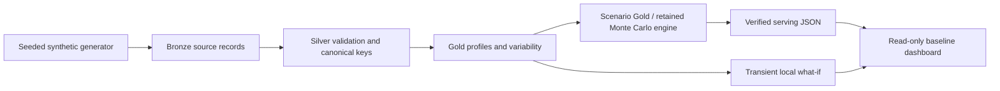

# Architecture and boundaries

This diagram describes the root-level synthetic demo. The existing
application and notebooks under `operational/` have a larger architecture;
see [the Workbench guide](full-project-workbench.md).

In AIDP Workbench, each layer is published to a dedicated Delta table and checked
by read-back. Storage access belongs to the managed runtime. No browser receives
storage or database credentials. Scenario outputs never become input evidence.

Locally, the exact transformation functions write JSON artifacts under `build/`.
This fallback demonstrates the analytical contract, not a local imitation of
Oracle infrastructure. Dashboard custom runs are explicitly local and do not
modify Gold or the baseline serving artifact.

The public backend is intentionally much smaller than the operational app:
standard-library HTTP bound to loopback, three allowlisted static files, one
baseline endpoint, one bounded what-if endpoint. It does not import an AKS
client, recorder, database connector, event archive or source-epoch service.

Missing by design: LIVE/GPS, real event cards, real participant roster, production
deployment, authentication, database serving, distributed Monte Carlo, ML model
registry, AI agents and automated OCI provisioning. Do not describe these as
implemented public capabilities.
